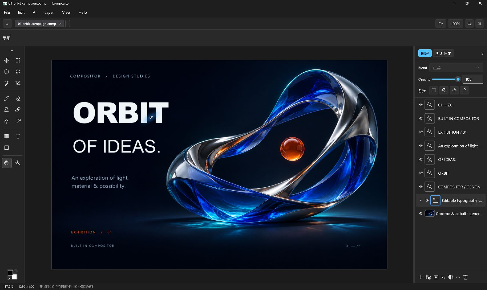

# Compositor for Windows

[English](README.md) | [简体中文](README.zh-CN.md)

A free, open-source Windows image editor built with C# and WinUI 3. Compose layers, edit photos,
and let an external AI agent operate the editor through MCP.

**Public Beta · Windows x64.** [Download the Beta](https://github.com/huguangyu666/Compositor-Windows/releases/tag/v1.0.0-beta.20261111).
Run `Compositor.App.exe` directly; .NET and WinUI runtimes are bundled. The complete ZIP also
includes the optional MCP server, agent skill, instructions and licenses.

The Beta is unsigned. Basic editing and save/reopen were checked on the development computer;
clean-machine and broader hardware compatibility remain unverified.



*A real app capture. MCP imported the artwork, created seven editable text layers, grouped them,
saved the project and exported the image. The background artwork was generated separately.*

## What you can do

- Compose images with layers, folders, blend modes, opacity, masks, adjustments and effects.
- Accelerate canvas composition with Direct3D 11, with automatic CPU fallback and a persistent switch.
- Animate layer visibility, position, scale, rotation and opacity; preview and export PNG sequences.
- Use a consistent Chinese or English interface selected from the Windows display language.
- Select, paint, crop, transform and arrange images; create editable text and shapes.
- Grade photos with Curves, Color Balance and locally masked adjustments.
- Configure a compatible image API, use selections and reference images, preview results and
  accept them as undoable layers.
- Connect an MCP client to inspect the live canvas and edit layers, typography, selections and masks.
- Watch a virtual AI cursor draw exact creation bounds before elements appear, with compact batch feedback.


- Generate with the agent's own image tools and return PNGs through MCP, with precise placement, selection-protected previews and one Undo; no editor API key is required.
- Import model-authored SVG as transparent raster layers.
- Use optional local SAM 2.1 point/box object selection, DirectML/CPU inference and a hollow-circle cursor.
- Scrub a smoother timeline with immediate subframe pointer movement and continuous playback indication.

## Let AI operate the editor

The MCP server exposes **32 live editing tools and 6 saved-project tools**. Local editing uses
the editor's normal operations and Undo history. The bundled
[compositor-mcp skill](Windows/skills/compositor-mcp/SKILL.md) provides workflows for grading,
layout, masks, AI preview and saving. See [connection and skill setup](Windows/docs/mcp.md).

> Use $compositor-mcp to grade the current photo with editable adjustment layers, show a
> before/after comparison and save the project.

> Turn this artwork into a poster. Keep the title and copy as separate editable text layers.

Explore the [editable ORBIT sample and MCP recipe](Windows/samples/README.md).

## Files and shortcuts

| Action | Shortcut | Format |
| --- | --- | --- |
| Open source document | Ctrl+O | Supported PSD/PSB documents |
| Import image as a layer | Ctrl+I | PNG, JPEG, TIFF and other supported flat images |
| Open native project | Ctrl+Shift+O | `.comp` project folder |
| Save editable work | File menu | `.comp` |
| Export flattened image | File menu | PNG/JPEG |

PSD/PSB import supports a subset of 8-bit RGB documents; PSD/PSB export is not implemented.
Preserve the `.comp` folder to keep layers editable. See [known limitations](Windows/docs/compatibility.md).

## Build and test

Install .NET 9 SDK on Windows, then run from the repository root:

```powershell
Push-Location Windows/ci
dotnet publish ../src/Compositor.App/Compositor.App.csproj -c Release -r win-x64 --self-contained true -p:Platform=x64 -p:PublishProfile=Portable-x64 -o ../artifacts/publish/app
dotnet publish ../tools/Compositor.Mcp/Compositor.Mcp.csproj -c Release -r win-x64 --self-contained true -p:PublishProfile=Portable-x64 -o ../artifacts/publish/mcp
Pop-Location
./Windows/ci/test-windows.ps1
```

Windows CI runs component tests, publishes both executables and checks MCP discovery.
It does not represent interactive or clean-machine acceptance.

## Privacy

Generative image edits send the **entire composite canvas**, selection mask, prompt and references
to your configured provider, even when editing a small selection. Third-party providers may retain
or use uploaded content. Review their data policies before sending sensitive images.

Local MCP editing needs no image API key, but previews enter the reasoning client's context.
Credentials are encrypted for the current Windows user and stored outside projects.

## Documentation and feedback

- [User guide](Windows/docs/user-guide.md)
- [MCP and skill](Windows/docs/mcp.md)
- [AI integration](Windows/docs/ai-integration.md)
- [Build and verification](Windows/docs/testing.md)
- [Documentation index](Windows/docs/README.md)
- [Report an issue](https://github.com/huguangyu666/Compositor-Windows/issues)

Include the app version, Windows version and steps to reproduce. Remove credentials and private
material from logs and screenshots.

## License and credits

[MIT](LICENSE). Based on [Compositor by Wonder Assembly](https://github.com/robbietilton/Compositor),
with the original copyright and license retained. This repository distributes the Windows implementation.

The experimental account adapter references the OAuth/image protocol from
[CLIProxyAPI](https://github.com/router-for-me/CLIProxyAPI), commit
`1f917e77c4562623aa49e9804d999524151a2f96`, under its
[MIT license](Windows/third-party/CLIProxyAPI-LICENSE.txt). It is implemented in C# and bundles no proxy executable.

Canvas GPU integration uses [Vortice.Windows](https://github.com/amerkoleci/Vortice.Windows)
by Amer Koleci and contributors under its [MIT license](Windows/third-party/Vortice-LICENSE.txt),
and [Win2D](https://github.com/microsoft/Win2D). Shader sources and compiled SM5 bytecode are included.

Local object selection uses [SAM 2.1](https://github.com/facebookresearch/sam2), [ONNX Community exports](https://huggingface.co/onnx-community/sam2.1-hiera-tiny-ONNX), [MobileSAM](https://github.com/ChaoningZhang/MobileSAM) and [ONNX Runtime](https://github.com/microsoft/onnxruntime). Model weights download separately; dependency licenses and attribution are retained in [third-party notices](Windows/third-party/Segmentation-NOTICE.txt).
