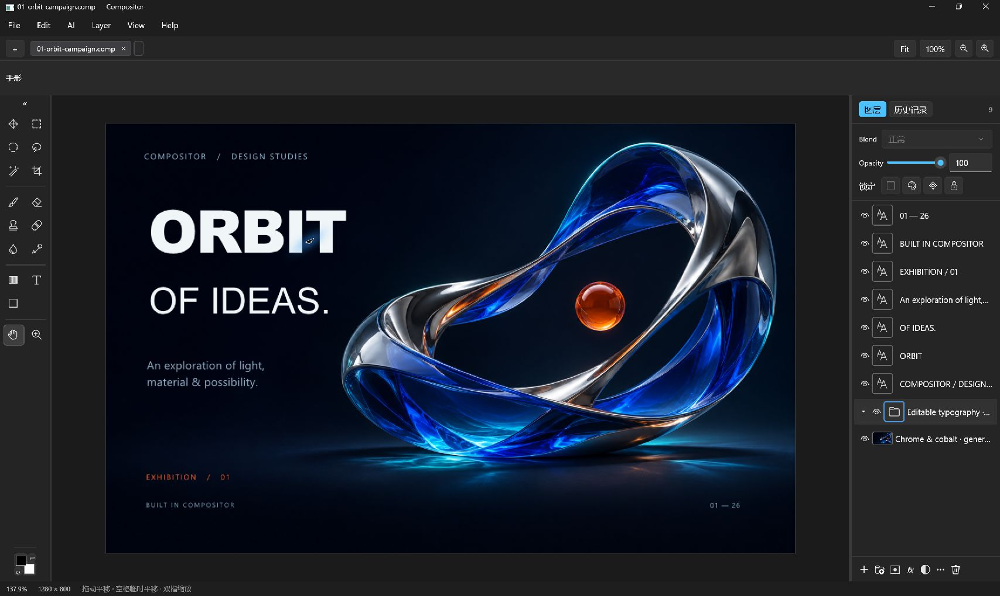

# Compositor for Windows

[English](README.md) | [简体中文](README.zh-CN.md)

免费开源的 Windows 图像编辑器，采用 C# 和 WinUI 3。支持图层合成、摄影调色、AI 图像编辑，以及通过 MCP 让外部 AI 直接操作软件。

**公开测试版 · Windows x64。** [下载 Beta](https://github.com/huguangyu666/Compositor-Windows/releases/tag/v1.0.0-beta.20261105.1)。
双击 `Compositor.App.exe` 即可启动，已内置 .NET 和 WinUI 运行库；完整 ZIP 另含 MCP 程序、配套 Skill、中文说明和许可证。

当前版本未签名，已在开发电脑上完成基本编辑、保存重开等验证，尚未验证干净系统和更多硬件环境。



*真实软件截图。图片导入、七层可编辑文字排版、分组、保存和导出均由 AI 通过 MCP 完成；主视觉背景由 AI 独立生成后导入。*

## 主要能力

- 图层、文件夹、混合模式、透明度、蒙版、调整层和图层效果。
- 选区、画笔、裁切、变换、对齐，以及可编辑文字和形状。
- 使用曲线、色彩平衡和局部蒙版调整进行摄影调色。
- 自行填写兼容服务的 API 地址与 Key，结合选区和参考图生成，预览后接受为可撤销图层。
- 接入 MCP，让外部 AI 读取实时画布、操作图层和文字、修改选区与蒙版。
- AI 创建元素时先用虚拟箭头拉出准确尺寸框，再显示内容；移动有过渡，批量操作简化反馈。

## 让 AI 直接操作编辑器

提供 **28 个实时编辑工具＋6 个项目文件工具**，实时操作进入正常编辑流程和撤销历史。
配套 [compositor-mcp Skill](Windows/skills/compositor-mcp/SKILL.md) 包含调色、排版、蒙版、AI 预览与保存流程，
安装方法见 [MCP 文档](Windows/docs/mcp.md)。

> 使用 $compositor-mcp 给当前照片调色，保留可编辑调整层，展示前后对比并保存工程。

> 把这张主视觉排成海报，标题和说明保留为独立文字图层。

[查看可编辑 ORBIT 海报与 MCP 制作参数](Windows/samples/README.md)。

## 文件与快捷键

| 操作 | 快捷键 | 用途 |
| --- | --- | --- |
| 打开源文档 | Ctrl+O | 支持范围内的 PSD/PSB |
| 导入图片 | Ctrl+I | 将 PNG、JPEG、TIFF 等平面图片加入图层 |
| 打开项目 | Ctrl+Shift+O | 原生 `.comp` 项目文件夹 |
| 保存 | 文件菜单 | 保留图层与可编辑数据的 `.comp` |
| 导出 | 文件菜单 | 平面 PNG/JPEG |

PSD/PSB 支持部分 8 位 RGB 特性，目前不支持导出 PSD/PSB。需要继续编辑时请保留 `.comp` 项目。
详见 [兼容性与已知限制](Windows/docs/compatibility.md)。

## 从源码构建

在 Windows 上安装 .NET 9 SDK，从仓库根目录执行：

```powershell
Push-Location Windows/ci
dotnet publish ../src/Compositor.App/Compositor.App.csproj -c Release -r win-x64 --self-contained true -p:Platform=x64 -p:PublishProfile=Portable-x64 -o ../artifacts/publish/app
dotnet publish ../tools/Compositor.Mcp/Compositor.Mcp.csproj -c Release -r win-x64 --self-contained true -p:PublishProfile=Portable-x64 -o ../artifacts/publish/mcp
Pop-Location
./Windows/ci/test-windows.ps1
```

GitHub Windows CI 执行组件测试、生成两个 EXE 并验证 MCP 工具发现；这些检查不等于交互或干净系统验收。

## AI 与隐私

生成式 AI 会把**完整合成画布（不限于选区）**、选区蒙版、提示词和参考图发送给所配置的服务商。
第三方中转站可能保存、使用或转售上传内容，请根据素材隐私要求选择服务。

本地 MCP 编辑不需要图像 API Key，但预览图会进入所用 AI 客户端的上下文。
凭据使用当前 Windows 用户加密存储，不写入项目。不要将 Key 放进截图、日志或反馈。

## 文档与反馈

- [用户指南](Windows/docs/user-guide.md)
- [MCP 接口与技能安装](Windows/docs/mcp.md)
- [AI 集成](Windows/docs/ai-integration.md)
- [构建与验证](Windows/docs/testing.md)
- [文档索引](Windows/docs/README.md)
- [提交问题](https://github.com/huguangyu666/Compositor-Windows/issues)

反馈请附程序版本、Windows 版本和复现步骤；截图及日志先去掉私人内容。

## 许可与致谢

采用 [MIT 许可证](LICENSE)，基于 [Wonder Assembly 的 Compositor](https://github.com/robbietilton/Compositor)，
保留原始版权与许可。本仓库发布 Windows 实现。

实验性账号适配器参考了 [CLIProxyAPI](https://github.com/router-for-me/CLIProxyAPI) 的 OAuth 与图像协议，
参考提交为 `1f917e77c4562623aa49e9804d999524151a2f96`，使用原生 C# 实现，没有内置代理 EXE。
其 [MIT 许可](Windows/third-party/CLIProxyAPI-LICENSE.txt) 随仓库保留。
