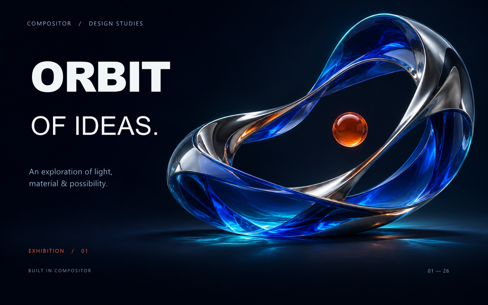

# MCP 制作样品 / Sample made through MCP

[可编辑工程 / Editable project](01-orbit-campaign.comp) ·
[真实软件截图 / Actual app capture](../docs/images/windows-orbit-workspace.jpg)

这张 1280 × 800 海报包含一张主视觉图片、七个原生文字图层和一个文字分组。
图片导入、文字排版、分组、保存和导出均通过实时 MCP 完成。窗口截图来自真实软件。

The 1280 × 800 poster contains one artwork layer, seven native editable text layers and one
typography group. Live MCP performed import, layout, grouping, save and export.

## 素材与制作 / Provenance

主视觉背景由内置 imagegen 工具独立生成，再通过 MCP 导入。海报文字由编辑器原生工具创建。
此样品展示 MCP 排版与合成；不表示背景通过本次软件内 API 请求生成。

The background was generated separately, then imported. Typography was created natively in
Compositor. The sample demonstrates MCP editing, not a successful in-app API generation request.

## 配方 / Recipe

[mcp-recipes.json](mcp-recipes.json) 包含整理后的最终 MCP 参数和背景提示词，并非原始调用日志。
使用返回的图层 ID 和最新 documentToken/revision；示例相对路径需解析为绝对路径。
实时 MCP 目前没有新建文档工具，请先在软件中创建空白文档，或打开现成工程。

The recipe contains consolidated parameters. Resolve IDs from tool results and use fresh state
for writes. Start with a blank 1280 × 800 document or open the finished project for inspection.
Fonts used are Arial Black, Arial and Segoe UI; rendering can vary with installed fonts.

## 验证 / Checks

最终 PNG 取自保存重开后的原生导出，工程保留七个可编辑文字层。
首次保存前的内存导出与重开后相比，691 个文字边缘像素最多相差 1/255。

The final PNG is the native export after reopening, retaining seven editable text records.
The first pre-save export differed at 691 text-edge pixels by at most 1/255 per channel.

软件许可见 [MIT](../../LICENSE)。样品用于展示编辑功能。
